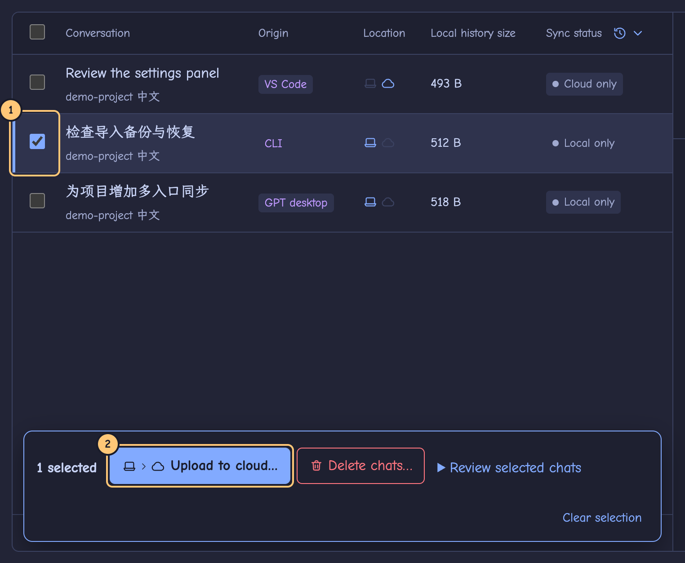

# Sesshuttle

English · [简体中文](README.zh-CN.md)

Continue the same Codex conversation on another computer. Choose a chat on your Mac, upload its encrypted history to your own Cloudflare R2 bucket, then import it on Linux and pick up where you left off. You choose which chats to transfer and when. Sesshuttle supports Codex in the GPT desktop app, CLI and VS Code.

## Install

Choose the 0.7.0 package for your computer. Public downloads will be available on [GitHub Releases](https://github.com/expldfsh/Sesshuttle/releases) after publication.

| Platform | Package |
| --- | --- |
| Apple Silicon Mac | `sesshuttle-0.7.0-mac-arm64.dmg` |
| Arch and other x86_64 Linux distributions | `sesshuttle-0.7.0-linux-x64.tar.gz` |
| Debian / Ubuntu x86_64 | `sesshuttle-0.7.0-linux-amd64.deb` |

## Move your first chat from Mac to Linux

The **Getting started** list at the top of Conversations tracks these steps until they are done.

1. **Connect both computers.** On the Mac, open Settings and choose **This is my first computer: create a sync space** with your private R2 bucket, then export the connection file. On Linux, choose **I already have a sync space: import its connection file** and enter your R2 Secret Access Key. [Set up R2 and connect both computers](docs/guides/en/quick-start.md#connect-both-computers)
2. **Upload on the Mac.** Click **Refresh**, tick your chat, then **Upload to cloud…**. Check the options, then the review list, and click **Confirm upload of …**. [See the marked review](docs/guides/en/quick-start.md#upload-from-the-first-computer)
3. **Import on Linux.** Click **Refresh**, open the cloud chat and choose **Import to this computer…**. The dialog takes you through three steps: the app, the project and its project folder, then the review list. Once verified, click **Continue**. Keep a copy of your project files on Linux for Codex to work on. [See the import steps](docs/guides/en/quick-start.md#import-and-continue)
4. **Bring your reply back.** After chatting on Linux, upload the updated chat. On the Mac, refresh and import it into the same app. If both computers changed the chat independently, compare versions before choosing which to import.

## Manage your history

- **Delete chats…** asks where (this device, the cloud, or both) and how (recycle bin or permanently), then lists every affected copy before you confirm. Other computers keep their local copies.
- **Sync activity** is one timeline of transfers and removals. Filter to what needs attention, retry unfinished work, or clear finished records; your chats and sync status stay.
- **Backups & recovery** has three tabs: manual device backups, the local trash and the cloud recycle bin. Importing and restoring do not create backups automatically.

[Full guide and troubleshooting](docs/guides/en/quick-start.md) · [Validation notes](docs/validation/0.7.0.md)
