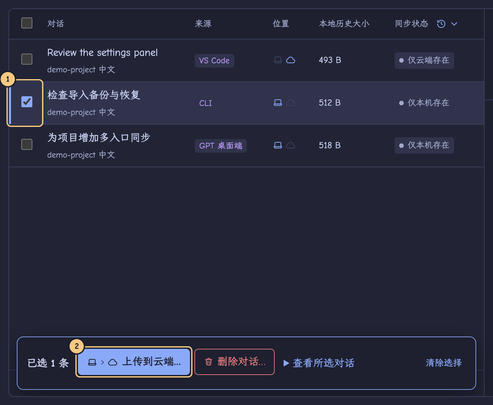

# Sesshuttle

[English](README.md) · 简体中文

在另一台电脑上继续同一个 Codex 对话。在 Mac 上选中对话，把历史加密上传到自己的 Cloudflare R2，再在 Windows 或 Linux 导入，接着聊。同步哪些对话、何时传输都由你决定。支持 GPT 桌面端中的 Codex、CLI 和 VS Code。

## 安装

本地构建的 0.9.0 安装包在 `release/`。已发布版本可从 [GitHub Releases](https://github.com/expldfsh/Sesshuttle/releases) 下载。

| 平台 | 安装包 |
| --- | --- |
| Windows 11 x64 | `sesshuttle-0.9.0-win-x64.zip` |
| Apple Silicon Mac | `sesshuttle-0.9.0-mac-arm64.dmg` |
| Arch 等 x86_64 Linux | `sesshuttle-0.9.0-linux-x64.tar.gz` |
| Debian / Ubuntu x86_64 | `sesshuttle-0.9.0-linux-amd64.deb` |

Windows 上先右键 ZIP 选择「全部解压缩」，再双击解压目录里的 **Sesshuttle.exe**。

首次打开时选择数据文件夹，以后直接点应用图标即可打开。选用 `~/Sesshuttle Data` 以外的位置时，应用会在个人主目录中用可见的 `Sesshuttle Location.json` 记住路径。升级时可迁移旧版数据和凭据，核对后再从设置清理旧位置。[选择位置、迁移和卸载](docs/guides/zh-CN/quick-start.md#你的-sesshuttle-数据文件夹)

## 第一次把对话从 Mac 带到 Windows 或 Linux

每台电脑「对话」页顶部的「开始使用」清单会列出第一次传输前还差的准备：检测本机 Codex 应用、连接云端存储、刷新对话列表、完成第一次上传或导入。全部完成后，清单不再显示。

1. **连接两台电脑。** 在 Mac 打开「设置」，选「这是第一台电脑：创建同步空间」，填入自己的私有 R2 Bucket，然后导出连接文件。在另一台电脑选「已有同步空间：导入连接文件」，输入 R2 Secret Access Key，加入同一空间。[从创建 Bucket 到连接两台电脑](docs/guides/zh-CN/quick-start.md#配置-r2-和连接文件)
2. **在 Mac 上传。** 点「刷新」，勾选对话，点「上传到云端…」。先看选项，再看检查清单，点写有对话数量的「确认上传」按钮。[查看标注过的检查清单](docs/guides/zh-CN/quick-start.md#在-mac-上传)
3. **在 Windows 或 Linux 导入。** 点「刷新」，点开云端对话，点「导入到这台电脑…」。弹窗分三步：选择应用、项目与文件夹、检查清单。验证通过后点「继续」。如果要接着改代码，先把项目文件放到接收端的工作目录。[查看导入步骤](docs/guides/zh-CN/quick-start.md#导入到-linux)
4. **把新消息带回 Mac。** 在接收端聊完后上传更新。回到 Mac，刷新并导入到原来的应用。如果两台电脑各自续写过，先比较版本，再决定导入哪一份。

## 整理历史

- **删除对话…** 先选位置（仅本机、仅云端或两者）和方式（移入回收站或彻底删除），确认前会列出受影响的每份副本。其他电脑保留各自的本机对话。
- **同步记录** 把传输和删除任务排成一条时间线。可筛选「需处理」、重试未完成的部分，或清除已结束的记录；对话和同步状态都会保留。
- **备份与恢复** 分为本机手动备份、本机回收站和云端回收站三个标签页。导入和恢复都不会自动创建备份。

[完整指南与常见问题](docs/guides/zh-CN/quick-start.md) · [验收记录](docs/validation/0.9.0.md)

## 发布新版本

每次推送分支都会编译四个安装包，可在 **Actions → Build and release** 里下载验收，保留七天。要对外发布，把带有新 `package.json` 版本号的提交推送到 `main` 即可。检查和打包全部通过后，工作流会打上版本标签，并将四个安装包和 SHA-256 校验清单上传到 GitHub Releases。0.x 版本和带预发布后缀的版本会标记为预发布。同一版本再次推送时，已发布的下载文件会保留。
