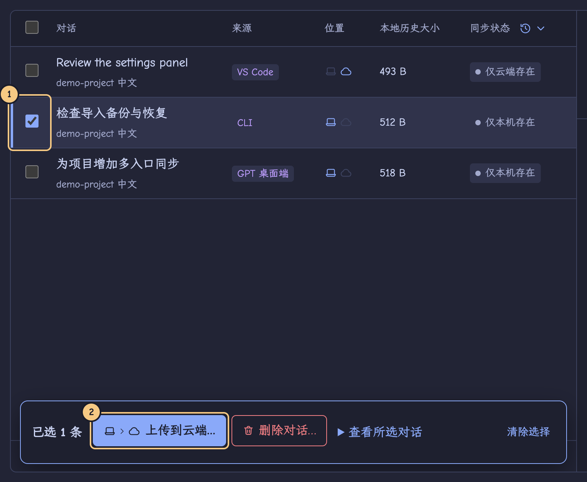

# Sesshuttle

[English](README.md) · 简体中文

在另一台电脑上继续同一个 Codex 对话。在 Mac 上选中对话，把历史加密上传到自己的 Cloudflare R2，再在 Linux 导入，接着聊。同步哪些对话、何时传输都由你决定。支持 GPT 桌面端中的 Codex、CLI 和 VS Code。

## 安装

按系统选择 0.5.0 安装包。公开发布后可从 [GitHub Releases](https://github.com/expldfsh/Sesshuttle/releases) 下载。

| 平台 | 安装包 |
| --- | --- |
| Apple Silicon Mac | `sesshuttle-0.5.0-mac-arm64.dmg` |
| Arch 等 x86_64 Linux | `sesshuttle-0.5.0-linux-x64.tar.gz` |
| Debian / Ubuntu x86_64 | `sesshuttle-0.5.0-linux-amd64.deb` |

## 第一次把对话从 Mac 带到 Linux

1. **连接两台电脑。** 在 Mac 的「设置」用自己的私有 R2 Bucket 创建同步空间，导出恢复文件。在 Linux 导入该文件，输入 R2 Secret Access Key，加入同一空间。[从创建 Bucket 到连接两台设备](docs/guides/zh-CN/quick-start.md#配置-r2-和恢复文件)
2. **在 Mac 上传。** 点「刷新」，勾选对话，点「上传到云端…」。核对标题、包含的附件和预计上传量，再点写有对话数量的「确认上传」按钮。[查看标注过的确认页](docs/guides/zh-CN/quick-start.md#在-mac-上传)
3. **在 Linux 导入。** 点「刷新」，选中云端对话，点「导入到这台电脑…」。选好目标应用、项目和本机工作目录，核对清单并确认。验证通过后点「继续」。如果要接着改代码，项目文件也要放到 Linux 上。[查看导入按钮和配置步骤](docs/guides/zh-CN/quick-start.md#导入到-linux)
4. **把新消息带回 Mac。** 在 Linux 聊完后上传更新。回到 Mac，刷新并导入到原入口。如果两台电脑各自续写过，先比较版本，再决定导入哪一份。

## 整理历史

- **删除对话…** 可选仅本机、仅云端或两者。确认前能核对受影响的副本。其他电脑保留各自的本机对话。
- **同步记录** 可以清除操作日志，对话和同步状态都会保留。
- **备份与恢复** 可以手动创建、恢复或删除本机备份。导入和恢复都不会自动创建备份。

[完整指南与常见问题](docs/guides/zh-CN/quick-start.md) · [验收记录](docs/validation/0.6.0.md)
