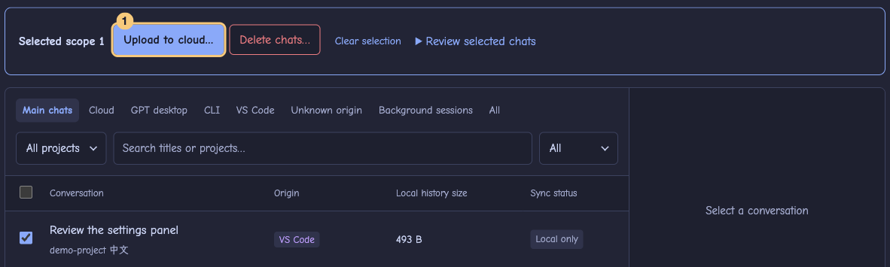
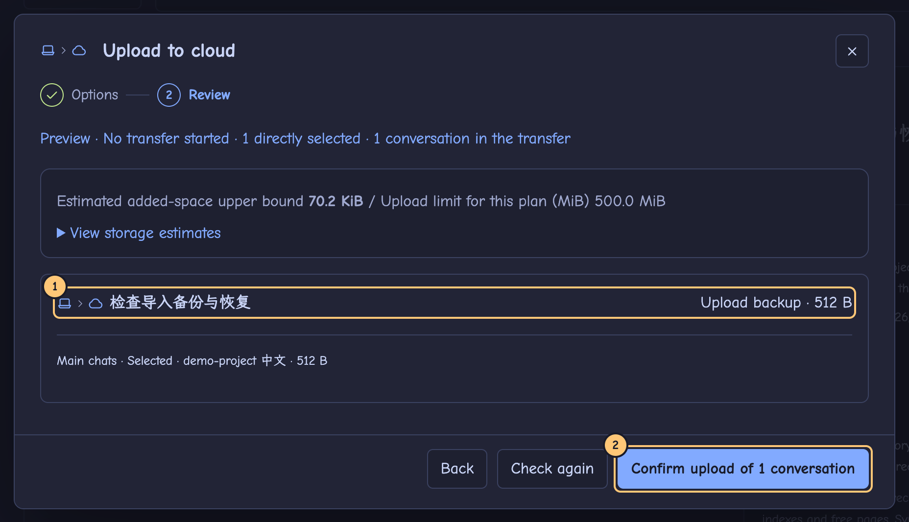
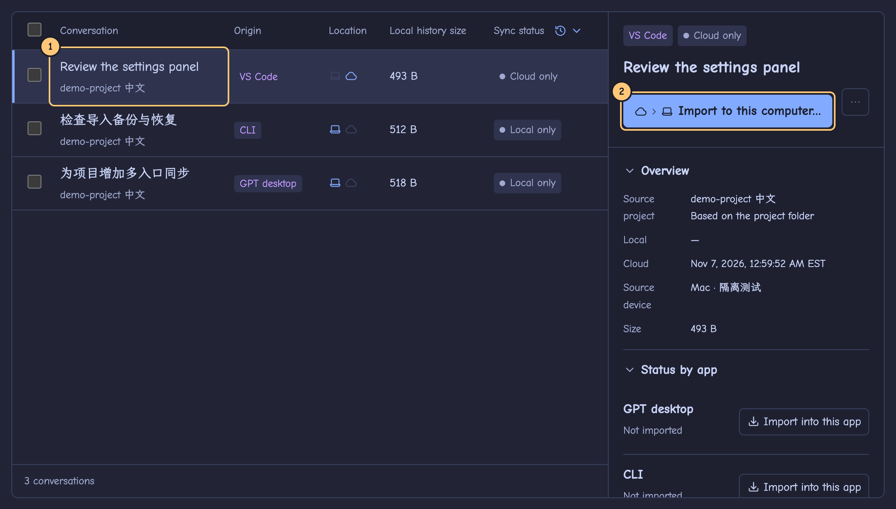

# Sesshuttle 0.7.1

If your Linux computer already shows the cloud chat, go straight to **Import and continue**. When upgrading, keep the existing sync space, application data and connection file.

Terms used here and in the app: an **app** is the GPT desktop app, the CLI or the VS Code extension; its **Codex runtime** is the `codex` program it runs; its **Codex data folder** (`CODEX_HOME`, often `~/.codex`) holds the history; the **project folder** is where your project files are when you continue; the **connection file** lets another computer join your **sync space**.

## Install or upgrade

- On Apple Silicon, open `sesshuttle-0.7.1-mac-arm64.dmg` and drag Sesshuttle into Applications. This local build has no Developer ID signature or notarization.
- On Arch Linux x86_64, run the commands below from the download folder in your graphical desktop session. Keep the extracted folder intact.
- On Debian or Ubuntu x86_64, install `sesshuttle-0.7.1-linux-amd64.deb` with your software installer or `sudo apt install ./sesshuttle-0.7.1-linux-amd64.deb`.

```sh
tar -xzf sesshuttle-0.7.1-linux-x64.tar.gz
./sesshuttle-0.7.1-linux-x64/sesshuttle
```

Install and sign in to the Codex apps you want to use on each computer. Bring project files to each computer yourself, for example with Git. Fonts are bundled.

The **Getting started** list at the top of Conversations shows four steps: detect Codex apps, connect cloud storage, refresh the list and finish a first upload or import. Use the buttons beside the first three steps; for the final step, select a chat and upload or import it. The list hides itself when all steps are done. You can also choose **Hide**.

## Connect both computers

1. In Cloudflare, create a private R2 bucket. Generate R2 credentials with **Object Read & Write** access scoped to that bucket. Save the Access Key ID and Secret Access Key and copy the S3 endpoint shown for your bucket. [Cloudflare setup](https://developers.cloudflare.com/r2/get-started/s3/) · [R2 credentials](https://developers.cloudflare.com/r2/api/tokens/)
2. On the first computer, open Settings and choose **This is my first computer: create a sync space**. The endpoint looks like `https://<ACCOUNT_ID>.r2.cloudflarestorage.com`; each field is checked as you leave it. **Test connection** shows its result next to the button.
3. After the space is created, the **Next: export the connection file** card stays until you choose **Export connection file**. The file holds the space decryption key and the Access Key ID. Keep it safe.
4. On the second computer, choose **I already have a sync space: import its connection file**. The endpoint, bucket, space and Access Key ID are filled in; enter the R2 Secret Access Key to join. **Enter connection details manually** is also available.
5. **Connected to your sync space** means the connection succeeded, and the top bar shows the connection with the first characters of the space ID. **View cloud chats** opens the list.
6. **Remember this connection on this computer** is checked by default. A locked Linux password store can open its system authorization window. Cancelling leaves you connected for this session; choose **Remember connection…** later to try again. If no provider is available, **Check credential storage** explains how to set one up.

## Upload from the first computer



**1** Tick the chat. **2** Choose **Upload to cloud…** in the action bar at the bottom of the list.

Filter by location, origin, project or status; the status chips show how many chats are in each state. The action bar also counts selected chats that the current filters hide. For one chat you can open it and use the button at the top of its details instead.

The upload dialog has two steps. **Options** sets whether to include background sessions of the selected chats, the upload limit (500 MiB by default) and whether to back up only what can be read. Then **Review** lists what will be transferred. Nothing is uploaded before you confirm.



**1** Check which chat is included. **2** Confirm only when the list and the estimated size look right.

To include a readable external image, approve it and update the review. You can locate another image or accept omissions individually or together for that chat where offered. The imported copy carries the omission notice and keeps its text and tool history. Missing required history or an unsafe resource needs repair before a verified import. If some chats are blocked, the reasons are listed and the confirm button names the eligible count.

After you confirm, the dialog closes and the task indicator in the top bar shows the stage and progress. Click it for details.

## Import and continue



**1** Open the cloud chat. **2** Choose **Import to this computer…** at the top of its details.

Use **Import to this computer…** to continue in Codex. **Download a cloud copy to a folder** in the **⋯** menu only exports files.

1. **Apps.** Select **GPT desktop**, CLI, VS Code or several apps. If paths are missing, use **Detect local Codex apps** in this step. Opening the Codex part of your GPT desktop app first helps detection find its running runtime and history database. Review the evidence and apply the paths you want. **Next** checks the chosen apps; if a step cannot continue, the reason is shown next to the button.
2. **Projects and folders.** Choose the project in the destination app, even if it has no chats yet, or **Import history only (no native project)**. Choose your project folder or **Create a dedicated project folder**.
3. **Review.** Check the destination app and project, close Codex processes that use the history, then choose **Confirm import to …**. The task reports cloud and per-app results separately. Use **Fix and retry** or **Retry this app** for a target that did not succeed.
4. Once an app is verified, choose **Continue** to open the chat there. If a native link is unavailable, open the app yourself and look for the title. Check the old messages and send the first new turn yourself. You can tell Codex you changed computers and give it the new folder. Sesshuttle sets the working directory without adding a model-facing message.
5. Upload the new turn and import it back on the first computer to continue the round trip.

You can go **Back** to an earlier step without losing your choices. Closing the dialog discards the review. If both computers edited the chat independently, choose **Compare versions** before importing.

### First import with a new Codex runtime

If the chosen app's Codex runtime has not been checked on this computer, **Next** shows **Run quick check** under it. Sesshuttle imports and continues a temporary sample chat and remembers a pass on this computer. Replacing the runtime can require a fresh check. You can still import history when native project assignment is unavailable. If continuation fails, the dialog explains why and offers another app or a download to an ordinary folder.

**Apps & projects** shows the same status for each app (configured and verified, quick check needed, Codex program missing, data folder missing) and whether each project folder exists. Changes there are saved from the bar at the bottom of the page.

## When something needs attention

Problems appear where they happened: in the dialog, the details panel or the task panel, with the button that fixes them. Only page-wide problems, such as a failed cloud check, appear as a banner above the list. If the dialog has closed or you have left the page, the problem appears at the top of the page instead. **Show technical details** reveals the error code and has a **Copy** button.

If an upload, import or removal cannot start, the task indicator in the top bar turns red and says so, for example **Upload not started**. The task panel keeps the record: why it stopped, that nothing was uploaded, imported or deleted, and a button to continue, such as **Refresh and preview again** or **Review the removal list again**. The record stays until you close it, use its button or start a new task of the same kind; refreshing or changing pages does not clear it. If a native app does not open, the error appears under that app's row or in the task panel and says that the app did not open and nothing changed.

| What you see | What to do |
| --- | --- |
| Connected, credentials kept only in memory | You can view and import now. Choose **Settings → Remember connection…** to retry system authorization. |
| An app is detected but its data folder or runtime is missing | Edit the paths for that app in the import dialog or on **Apps & projects**, then check again. Opening the destination app's Codex page helps detection. |
| The cloud chat does not appear | Make sure both computers joined the same space, check the task result on the uploading computer, refresh and **Clear filters**. A failed cloud check keeps the previous list. |
| Codex is using the history, or the review is out of date | Save your work and quit Codex, or refresh, then review again. Nothing is imported before you confirm. If the review went out of date before you confirmed, the task does not start; choose **Refresh and preview again** in the task panel to get a new review list. |
| One app failed | Open the task and choose **Fix and retry** for that app. Uploaded and verified targets are listed separately. If recovery is needed, open **Backups & recovery**. |
| Both computers continued the chat | Choose **Compare versions**, then pick the version and target. Local versions that need protection are kept before importing. |

On Arch, choose **Remember connection…** in Settings, or **Unlock and connect…** when a secure credential is already saved. Enter your password only in the system window. If diagnostics report no Secret Service, install a provider such as GNOME Keyring (`sudo pacman -S --needed gnome-keyring`), sign in to the desktop again if needed, and retry. [Arch package](https://archlinux.org/packages/extra/x86_64/gnome-keyring/)

## Delete chats and manage recovery copies

1. Open a title or tick several chats, then choose **Delete chats…**. Choose where (**This device only**, **Cloud only** or **This device and cloud**) and how (**Move to recycle bin** or **Delete permanently**). Each card says what the choice affects. Each new review defaults to recycling.
2. **Review affected copies** lists device folders, shared apps, dependencies, attachments and retained copies. Cloud versions show the source computer, time, size, included histories and attachments. Untick any versions to keep, wait for the review to update, then check which versions will be available afterward.
3. Close Codex writers before changing local history. Before the first cloud removal in an existing space, finish older transfers and upgrade every computer that uses the space to 0.3.0 or later.
4. Permanent deletion requires an extra acknowledgement, and its red final button names the locations and counts. Results are reported per location. If one location fails, review and retry only the unfinished work.
5. **Backups & recovery** shows the local trash as soon as you open it, and updates it as soon as you restore or permanently delete an entry. The cloud recycle bin is read when you choose **Refresh cloud recycle bin**, and shows when it was last checked. Restore an entry or permanently remove the recycled copy from there. After an action that changes the cloud, the list is marked as possibly out of date and its buttons wait until you refresh it.

Recycling keeps the storage in use. Permanent cleanup releases only unshared objects in the selected space. On another computer, imported chats keep working and a refresh does not upload them again. An interrupted cloud cleanup can be finished from the cloud recycle bin.

## Backups and activity

Previews, downloads, imports and restores do not create local backups. In **Backups & recovery → Manual device backups**, choose a Codex data folder and **Create device backup**. Codex can stay open; if history changes during the copy, retry when writes have stopped. Restoring and deleting a backup open a confirmation that summarizes the backup and lists the files to be removed.

**Sync activity** is one timeline of transfers and removals, newest first. **Needs attention** shows only tasks that need you. Expand a task for its details, tick finished records and choose **Clear selected**, or **Clear all records**. **Load more** shows older tasks.

## Keyboard shortcuts

⌘/Ctrl+R refreshes the conversation list when nothing else runs, ⌘/Ctrl+F focuses search and Esc closes the topmost dialog. In the list, ↑/↓ move and show details, Space ticks the current row and ⌘/Ctrl+A selects the current view. Apart from refresh, shortcuts never start a data operation. The list is also in **Settings**.

## Linux acceptance checklist

Use this when a chat uploaded from the Mac is visible on Linux. Both computers run Sesshuttle 0.7.1 and keep their sync space, application data and connection file.

1. **Detect the desktop app.** On Linux, open the Codex page of the GPT desktop app. In Sesshuttle, open **Apps & projects → Detect local Codex apps**, check the runtime, data folder and evidence under **GPT desktop**, and apply them. `/usr/lib/chatgpt/ChatGPT` is one known location of the desktop program itself, which is not the runtime.
2. **Choose the chat.** In Conversations, open your uploaded title and choose **Import to this computer…**. If it is missing, choose **Settings → View cloud chats** and refresh. Select **GPT desktop**.
3. **Choose the real project.** In **Projects and folders**, pick the `linux` project from the Linux sidebar, even if it is empty. Choose an existing project folder or create a dedicated one. If only history-only import is offered but you need the project, check the runtime version and the actual data folder.
4. **Run it.** Choose **Review transfer**, check the title, project and app, quit Codex apps that use the history and confirm.
5. **Check in GPT.** Wait until the target is verified with the project name. Choose **Continue**, or open the `linux` project in the desktop app and find the title. The early messages, tool records and expected images must be visible; an omitted image shows its notice.
6. **Hand over yourself.** Tell Codex you switched to Linux and give the folder, ask it to recall something agreed earlier, and check that the new turn stays in the same chat.
7. **Go back.** Upload from Linux, refresh on the Mac, import into the original app and continue there.

To check the connection hand-over, export the connection file on the connected Mac, import it on an unconnected Linux installation, enter the Secret Access Key and connect. To check removal, use a dedicated test chat: recycle one cloud version on the Mac, confirm the imported Linux chat still opens, and restore the version from the Linux cloud recycle bin. Open a permanent deletion review and cancel it to check its two-sided list and final button.

[Verification report](../../validation/0.7.1.md)
