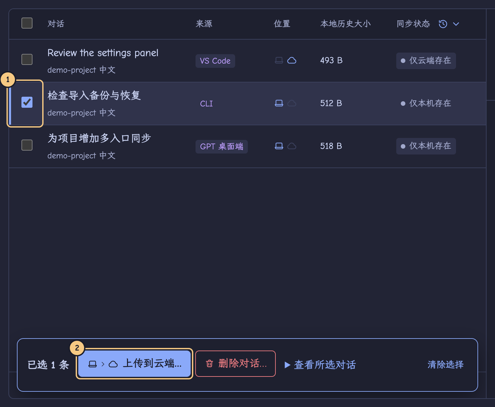
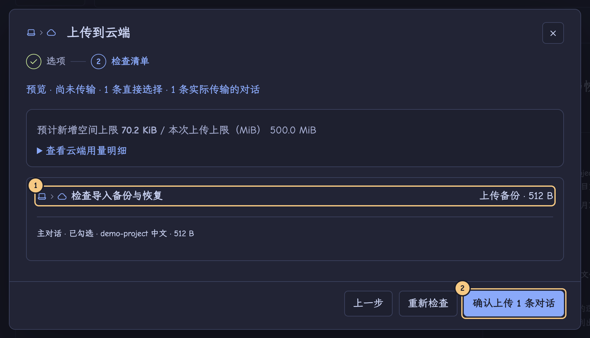
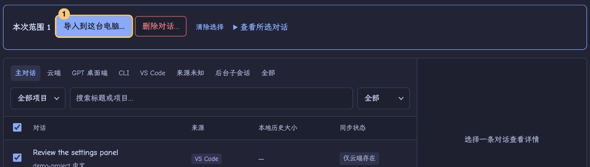

# Sesshuttle 0.7.1 使用指南

两台电脑都已连上 R2，并且 Linux 已经能看到云端对话时，从下面的「导入到 Linux」开始。升级时保留原同步空间、应用数据和连接文件。

本指南与界面使用同一套说法：**应用**指 GPT 桌面端、CLI 或 VS Code 扩展；**Codex 程序**是应用实际运行的 `codex` 可执行文件；**Codex 数据目录**（`CODEX_HOME`，常见为 `~/.codex`）保存历史；**项目文件夹**是继续对话时项目文件所在的位置；**连接文件**让另一台电脑加入你的**同步空间**。

## 安装或升级

- **Mac Apple Silicon** 打开 `sesshuttle-0.7.1-mac-arm64.dmg`，将应用拖到“应用程序”。本地包未做 Developer ID 签名和公证。若系统提示拦截，核对文件来源后在系统“隐私与安全性”中处理。
- **Arch Linux x86_64** 在安装包所在目录运行下面两行，保持解压出的目录完整，在自己的图形桌面会话中启动。
- **Debian / Ubuntu x86_64** 用软件安装器打开 `sesshuttle-0.7.1-linux-amd64.deb`，或在包所在目录运行 `sudo apt install ./sesshuttle-0.7.1-linux-amd64.deb`。

```sh
tar -xzf sesshuttle-0.7.1-linux-x64.tar.gz
./sesshuttle-0.7.1-linux-x64/sesshuttle
```

升级时退出旧版，保留原有应用数据。两台电脑分别安装并登录要使用的 Codex 应用。项目代码通过 Git 或自己的文件传输方式准备。

「对话」页顶部的「开始使用」清单列出四步：检测本机 Codex 应用、连接云端存储、刷新对话列表、完成第一次上传或导入。前三步可通过对应按钮操作；最后一步需选中对话后上传或导入。全部完成后清单自动收起，也可以点「隐藏」。

## 配置 R2 和连接文件

1. 在 Cloudflare 控制台进入 **Storage & databases → R2 → Overview → Create bucket**，输入名称并创建私有 Bucket。[创建 Bucket](https://developers.cloudflare.com/r2/get-started/s3/)
2. 在 R2 的 **API Tokens → Manage** 创建凭据，权限选 **Object Read & Write**，限定为该 Bucket。保存 **Access Key ID**、**Secret Access Key**，复制控制台提供的 **S3 endpoint**。带区域限制的 Bucket 使用该区域显示的地址。[R2 凭据说明](https://developers.cloudflare.com/r2/api/tokens/)
3. 首台电脑在「设置」选「这是第一台电脑：创建同步空间」，填入 endpoint（形如 `https://<ACCOUNT_ID>.r2.cloudflarestorage.com`）、Bucket 名称和两项访问凭据。离开输入框时会立即检查格式；「测试连接」的结果显示在按钮旁边。
4. 创建空间后，「下一步：导出连接文件」卡片会一直显示，直到你点「导出连接文件」并保存成功。连接文件含空间解密密钥和 Access Key ID，请妥善保管。
5. 第二台电脑在「设置」选「已有同步空间：导入连接文件」。endpoint、Bucket、同步空间和 Access Key ID 会自动填好，输入 R2 Secret Access Key 后即可加入。也可以点「改为手动输入连接信息」。
6. 看到「已加入同步空间」即可「查看云端对话」，顶栏会显示连接状态和空间 ID 的前几位。默认勾选「在这台电脑记住连接」，系统可能要求授权。也可以取消，稍后在设置里点「记住连接…」。

## 在 Mac 上传



**①** 勾选对话。**②** 在列表底部的操作栏点「上传到云端…」。

可以按位置、来源、项目或状态筛选；状态标签上显示各状态的数量。操作栏会提示有几条已选对话不在当前筛选中。只传一条时，也可以点开对话，用详情顶部的按钮。

上传弹窗分两步。「选项」可设置是否包含所选对话的后台子会话、本次上传上限（默认 500 MiB）以及是否只备份可读取的内容；「检查清单」列出本次实际传输的内容。确认前不会上传历史。



**①** 核对本次包含的对话。**②** 确认清单和预计用量后，点此开始上传。

对外部图片可逐项授权并更新清单。缺图时可重新指定图片，或逐张接受省略，也可一次接受这个对话中列出的可省略图片。导入后会保留文字、工具历史及缺图说明。关键历史丢失或损坏时，须先在来源设备找回。若部分对话受阻，清单会列出原因，确认按钮写明可处理的数量。

确认后弹窗关闭，顶栏右侧的任务指示器显示当前阶段和进度，点击可展开任务面板。

## 导入到 Linux



**①** 点开云端对话。**②** 在详情顶部点「导入到这台电脑…」。

要在 Codex 里继续聊，请选「导入到这台电脑…」。「⋯」菜单里的「仅下载云端副本到文件夹」只用于另存历史文件。

1. **选择应用。** 勾选「GPT 桌面端」，也可同时选择已安装的 CLI、VS Code。缺少路径时，在这一步点「检测本机 Codex 环境」。如果还未识别桌面端，先在 GPT 桌面程序打开 Codex 页面，再检测，核对依据后采用所需路径。点「下一步」才会检查所选应用；不能继续时，原因直接写在按钮旁。
2. **项目与文件夹。** 选择目标应用中的项目（项目可以是空的），或「仅导入历史（不指定原生项目）」。再选择项目文件夹，或点「创建并使用专用项目文件夹」。
3. **检查清单。** 核对目标应用和项目，保存正在进行的 Codex 工作并退出使用该历史的应用，再点「确认导入到 …」。任务会分别列出云端和每个应用的结果。某个应用失败时，点「修复并重试」或「只重试此应用」。
4. 在验证通过的应用点「继续」，到原生应用查看对话。若系统没有注册对应的打开方式，手动打开应用并在选定项目中找到标题。打开后由你自己说明已换电脑，给 Codex 当前文件夹或新任务。导入会设置新命令的工作目录，不会替你向模型发送环境说明。
5. 上传新的一轮，再导入回第一台电脑，完成往返。

可以点「上一步」返回，已选内容会保留。关闭弹窗会放弃本次清单。两台电脑各自续写过时，先点「比较并选择版本」再导入。

### 首次使用这个 Codex 程序导入

如果所选应用的 Codex 程序还没有在这台电脑验证过，点「下一步」后会在它下方显示「快速验证此 Codex 程序」。Sesshuttle 用临时对话验证能否导入并继续，通过后这台电脑会记住结果。更换 Codex 程序后可能需要重新验证。项目归属不可用时，仍可仅导入历史。若不能续聊，弹窗会说明原因，也可选择其他应用或把云端副本下载到普通文件夹。

「本机应用与项目」页的应用卡片显示同样的状态（已配置并验证、需要快速验证、缺少 Codex 程序、缺少数据目录），项目行会标出所选项目文件夹是否存在。在这里修改后，用页面底部的「保存设置」保存。

## 遇到提示后如何继续

问题会显示在发生的位置：弹窗内、详情区或任务面板，并带有对应的修复按钮。只有整页级的问题（例如云端检查失败）才会显示在列表上方的横幅里；弹窗已关闭或已离开原页面时，提示也会改到页面顶部。「查看具体原因」可展开错误码，并有「复制」按钮。

上传、导入或删除未能开始时，顶栏任务指示器变为红色，写明「上传未开始」「导入未开始」或「删除未开始」等，任务面板保留这条记录：说明原因，写明没有上传、导入或删除任何内容，并给出继续的按钮，例如「刷新并重新预览」或「重新查看删除清单」。记录会一直保留，直到你关闭它、点了恢复按钮，或开始了新的同类任务；刷新列表或切换页面不会清除它。打开原生应用失败时，错误显示在该应用行下方或任务面板中，并说明应用没有打开、对话和项目数据没有改变。

| 界面情况 | 下一步 |
| --- | --- |
| 已加入空间，凭据只保留在内存 | 本次可以直接查看和导入。点「设置 → 记住连接…」即可重试系统授权。下次打开时，若系统密码库锁定，会再请求解锁。 |
| 检测到应用，仍缺 Codex 数据目录或 Codex 程序 | 在导入弹窗或「本机应用与项目」编辑该应用的路径，再重新检查。打开目标桌面端的 Codex 页面有助识别实际数据位置。 |
| 云端暂时看不到对话 | 确认双方加入同一空间，检查上传设备的任务结果，刷新当前设备并点「清除筛选」。云端检查失败时保留上次的列表。 |
| 目标正在使用历史、清单已过期 | 保存工作并退出 Codex，或刷新后重新检查清单。确认前不会导入。确认时清单已过期的，任务不会开始，在任务面板点「刷新并重新预览」即可回到新生成的检查清单。 |
| 缺少父历史 / 只有索引 | 在来源设备核对原记录、压缩历史及清单给出的父对话标识，补齐后再检查。保留索引有助定位原历史。 |
| 某个应用失败 | 展开任务，在失败的应用点「修复并重试」。已经上传和验证通过的目标分开列出。提示恢复时先到「备份与恢复」。 |
| 两边分别续写 | 点「比较并选择版本」，确认版本、来源设备和目标。导入前会保留需要保护的本机版本。 |

**Arch 密钥环**　通常可直接在「设置」点「记住连接…」，已有安全凭据时点「解锁并连接…」。密码只在系统窗口输入。如诊断提示未发现服务，可在图形桌面终端运行下面的命令核对。

```sh
busctl --user introspect org.freedesktop.secrets /org/freedesktop/secrets org.freedesktop.Secret.Service
```

若服务缺失且希望使用 GNOME Keyring，可安装 `sudo pacman -S --needed gnome-keyring`，在应用内重试。如果安装后当前桌面会话仍找不到服务，重新登录图形桌面再试。仅在内存中的连接在退出后需重新加入同一空间。[Arch 软件包](https://archlinux.org/packages/extra/x86_64/gnome-keyring/)

[用已有云端对话在 Arch 验收](linux-acceptance.md) · [验收记录](../../validation/0.7.1.md)

## 手动备份和同步记录

预览、下载、导入和恢复都不会创建本机备份。前往「备份与恢复 → 本机手动备份」，选择 Codex 数据目录，点「创建本机备份」并确认。创建时可以开着 Codex；如果这期间有历史变动，等写入结束后重试。恢复或删除备份时，确认弹窗会列出备份摘要和将要移除的文件，危险操作的按钮写明对象。

「同步记录」把传输和删除任务按时间排成一条时间线。「需处理」只显示需要你处理的任务。展开任务可查看详情；勾选已结束的记录后点「清除所选」，或点「清空记录」。「加载更多」显示更早的任务。对话、云端版本、备份和同步状态都会保留。

## 删除对话或备份版本

1. 点对话标题或勾选多条对话，点击「删除对话…」。在卡片中选择**删除位置**（仅本机 / 仅云端 / 本机和云端）和**删除方式**（移入回收站 / 彻底删除），每张卡片下写明影响。默认移入回收站。
2. 点「查看处理清单」。本机部分显示设备、受影响的应用和目录、主对话及依赖、独占附件及会保留的共用附件和项目文件。清理先前回收的副本时，会标明实际回收目录和原位置。
3. 云端部分逐项列出对话和版本，包括设备、时间、大小、分支和其中打包的历史与附件。可取消勾选要保留的版本，等待清单自动重算。先读「完成后可导入」和「会保留的其他副本」，再确定是否继续。
4. 执行本机历史删除或恢复前，请先保存工作并退出使用该历史的 Codex。首次在已有空间使用云端删除时，须先结束旧版传输，将访问此空间的各台设备更新到 0.3.0 或更高，再确认空间升级。原连接文件继续有效。
5. 永久删除另有确认，红色的最终按钮写明位置、本机对话数和云端版本数。操作结果按位置显示，也可在「同步记录」回看。部分完成时选「查看并重试未完成部分」。

| 位置 | 移入回收站 | 彻底删除 |
| --- | --- | --- |
| 仅本机 | 可在这台电脑恢复，R2 副本保留。 | 清理这台电脑所列历史与独占附件，R2 副本保留。 |
| 仅云端 | 在当前 R2 空间回收指定版本，加入同一空间的设备可恢复。 | 清理指定版本和没有其他引用的对象。已导入到各台电脑的对话保留。 |
| 本机和云端 | 将本机历史和云端版本移入各自回收站，可分别恢复。 | 逐侧清理清单中的副本，其他电脑的本机历史保留。 |

回收站仍占用空间。「备份与恢复 → 本机回收站」打开即显示本机已保存的记录，恢复或彻底删除后当前列表会立即更新。「云端回收站」需要点「刷新云端回收站」才会读取云端，并显示上次检查时间；在其中恢复、彻底删除或完成收尾后，列表会标为可能已过期，刷新后才能继续操作。在回收站中可选「恢复副本…」或「彻底删除…」。

**在另一台电脑刷新**　若已导入过该对话，仍可在原生应用继续。最后一个云端版本被移除后，已有本机副本的设备在列表显示「仅本机存在」。回收的云端版本可以恢复后再次下载。永久删除后仍可从保有本机历史的设备重新上传。

**操作中断**　若显示「云端操作待收尾」，可在原任务重试，也可到「备份与恢复 → 云端回收站」完成原清单。若提示另一设备仍占用写入，请等待，或在当时发起操作的设备重新打开并重试。本机中断且提示需要恢复时，在本机回收站恢复该条记录。

## 快捷键

⌘/Ctrl+R 在空闲时刷新对话列表，⌘/Ctrl+F 聚焦搜索框，Esc 关闭最上层的弹窗。列表中 ↑/↓ 移动并显示详情，空格勾选当前行，⌘/Ctrl+A 全选当前视图。除刷新外，快捷键不会开始任何数据操作。「设置」页也列出了这些快捷键。
