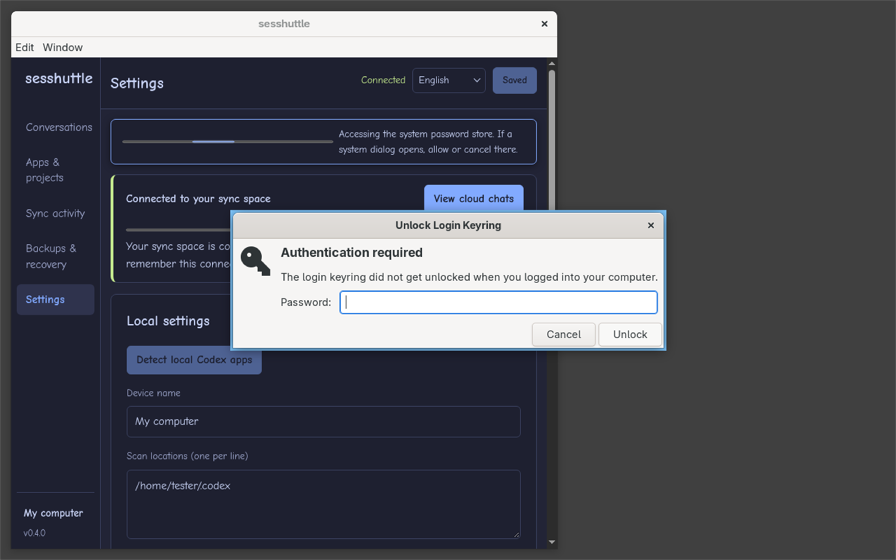

# Sesshuttle 0.4.0 验证记录

测试使用合成对话、独立的 Codex 历史目录、临时应用配置和本机对象存储。Mac 使用 Apple Silicon，Arch Linux 在 x86_64 虚拟机中以普通用户运行。正式凭据流程的 Linux 测试使用测试账号自己的 GNOME Keyring。虚拟机没有外网默认路由，测试用 S3 域名解析到回环地址。

## 换机连接

| 场景 | 实际结果 |
| --- | --- |
| Mac 导出，Arch 导入 | 从 DMG 启动应用并导出。在 Arch 解压包的设置中导入。地址、Bucket、空间、Access Key ID 均自动填入，Secret 输入框为空。补填测试 Secret 后成功加入并导出。 |
| Arch 导出，Mac 导入 | 在全新的 Mac 应用配置中导入 Linux 文件，核对上述字段，从界面加入原测试空间，再次导出。两边导出的测试文件内容一致。 |
| 旧文件没有 ID | 全新 Mac 配置实际显示重新导出或补填 ID 的指引，填写后可加入及重新导出。同设备重用旧 ID 要求地址、Bucket、空间均匹配。另测了格式错误、切换目标、文件不包含 Secret。 |

图形检查只为系统文件选择器指定测试文件。文件读取、导出、表单、连接按钮和空间验证走安装包的正常流程。恢复文件带空间解密密钥，须妥善保存。

## Linux 系统授权

使用 niri 26.04、GNOME Keyring 51.1 和 GCR 4.4.1。Electron 使用 `basic_text` 后端，以便核对 Sesshuttle 自己请求桌面 Secret Service 的路径。

- 勾选「在这台电脑记住连接」，用最终安装包加入测试空间。界面先显示已连接，当系统密码库处于锁定状态时弹出 GNOME 的「Unlock Login Keyring」。在真实系统窗口等待超过 15 秒再输入测试用户密码，凭据成功保存。
- 首次保存时取消，界面保留已连接状态，可以查看云端对话。在同一窗口点「记住连接…」并授权，保存成功。
- 退出、重新锁定测试密码库并重开安装包，系统请求授权。取消后点「解锁并连接…」，再次授权就能从密码库恢复并打开原空间，无需重新输入 R2 凭据。
- 将测试进程指向不存在的本地会话总线，诊断返回密码库服务不可用，已经建立的云端连接继续可用。

## 对话、批量操作和删除

- 使用两个系统实际的 Codex 内核和回环模型服务。Mac 创建的三轮历史传到 Arch 后可继续到五轮，核对原生项目归属和新工作目录。传回 Mac 继续到七轮，再次核对早期上下文和工作目录。新消息由测试用户明确发送。Mac 回程选择了仅导入历史。
- 缺图样本使用压缩的原生历史。确认省略图片后两端仍能接着聊，文字、工具历史和缺图说明保留，来源历史哈希相同。只有数据库记录的另一组样本可显式选择仅备份可读内容，原生导入在写入前被拦下。
- 从最终 Mac 窗口勾选两条。对可用对话一次接受两张缺图，再点击「仅上传可用的 1 个对话」。最终记录显示一条已上传，另一条因缺必要父历史被跳过。引擎同时验证缺少某一条目的确认时整批不会提前写入。
- 1,677,813,136 字节（约 1.56 GiB）的合成历史分为 401 块，预览、加密往返、还原和完整内容哈希检查通过。加密缓存命中可复用，损坏的缓存块会重新读取并认证。
- Mac 和 Arch 各执行本机、云端、两处分别回收或永久删除六种组合。核对共享对象、其他设备的独立历史、并发版本和只重试未完成的一侧。在最终 Mac 界面取消勾选一个云端版本，确认数量自动从 2 更新为 1，随后取消预览。

## 安装包与验证边界

- Mac 上 56 项核心检查通过，Arch 另跑 11 项删除与恢复检查。类型检查及 628 条中英文界面消息检查通过。
- 三份安装包对应运行代码及版本提交 `07eea06`。复核 DMG 镜像、Linux 压缩包、Debian 包的架构和归档内容，逐文件比对两平台的主程序、界面、字体和许可证。交付目录另有 `SHA256SUMS-0.4.0.txt`。
- 图形授权实测覆盖 Arch + niri + GNOME Keyring。KWallet、KeePassXC 和 macOS 锁定个人登录钥匙串后的授权窗口未在本轮实测。macOS 已从最终 DMG 验证双向连接文件和实际同步界面。Debian 包验证了架构和内容。
- 用户工作账户、真实 R2 和用户 Linux 上 GPT 客户端的侧栏保留给设备验收。Mac 包为本地构建，未经 Developer ID 签名与公证。

[在自己的设备上验收](../guides/zh-CN/linux-acceptance.md)
